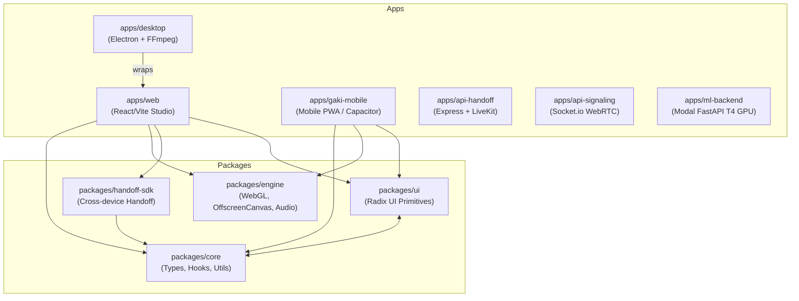

# Architecture Overview

GAKI House is a **pnpm + Turborepo monorepo** for a browser-based and Electron-wrapped live broadcast studio, mobile remote camera/stream deck, and supporting backend services.

## Monorepo Diagram



## Layer Architecture (`apps/web`)

```
Pages (route orchestrators: Index.tsx, Mobile/, etc.)
  └── Features (domain modules: ai-assistant, canvas, caption, stream, vault, animation, auth, omegle, theme)
        └── Stores (Zustand global state in src/stores/ and src/store/)
              └── Hooks (reusable logic: useAutoFraming, useSnapGuides, useKeyboardShortcuts, etc.)
                    └── Kernel (@gaki/engine: BroadcastBus, GLRenderer, ShaderManager, OffscreenCanvas worker)
                          └── Lib & Shared (ai.ts, assetApis.ts, zIndex.ts, @gaki/core, @gaki/ui)
```

## Core Data Flows

### Studio Compositing & Streaming (Electron)
```
User Interaction / Scene Edits
  └── useSceneStore (Zustand)
        └── BroadcastBus + OffscreenCanvas Worker (packages/engine)
              └── Main-thread 1920x1080 canvas -> captureStream() -> MediaRecorder (WebM)
                    └── window.electron.stream.sendData(chunk) [preload IPC]
                          └── ipcMain ('stream:data') -> FFmpeg stdin -> RTMP FLV (YouTube/Twitch/Kick)
```

### AI Overlay Generation
```
Voice/Text Command (AICommandPopover / useDeepgramSpeech)
  └── lib/ai.ts -> processCommandWithAgent() -> Gemini API
        └── HTML/CSS/JS string -> useSceneStore -> Sandboxed <iframe> overlay
```

### Live Captions
```
Microphone -> getUserMedia() -> useContinuousAudio (MediaRecorder chunks)
  └── useDeepgramSpeech (WebSocket -> Deepgram Nova-2)
        └── CaptionRenderer -> Dynamic Animation Style Component
```

### Cross-Device Handoff
```
apps/web <-> packages/handoff-sdk <-> apps/api-handoff (LiveKit token vending)
```

### Omegle Mode (Random Chat Matching)
```
apps/web (SignalingClient / WebRTCConnection) <-> apps/api-signaling (Socket.io)
```

## State Management

Global state lives in Zustand stores (`apps/web/src/stores/` and `apps/web/src/store/`). Cross-cutting concerns (logging, debug, auth, theme) use React Context.

| Store | Location | Purpose |
|---|---|---|
| `useSceneStore` | `src/stores/scene.store.ts` | Active overlays (AI, text, file, browser), captions, filters, camera effects, undo/redo |
| `useStreamStore` | `src/stores/stream.store.ts` | Broadcast/recording status, persisted `destinations`, countdown, fatal errors |
| `useMediaStore` | `src/stores/media.store.ts` | Audio/video device lists, active mic/camera toggles, screen share mode |
| `useCanvasStore` | `src/stores/canvas.store.ts` | Zoom, pan offsets, viewport dimensions |
| `useUiStore` | `src/stores/ui.store.ts` | Fullscreen, sidebars, settings/sessions/animation modals, chatbot panel |
| `useOmegleStore` | `src/stores/omegle.store.ts` | Random chat matching state |
| `useSceneAudioStore` | `src/stores/sceneAudio.store.ts` | Per-scene audio volume and mute state |
| `useGoLiveStore` | `src/stores/goLive.store.ts` | Go-live modal state |
| `useStreamManagerStore` | `src/stores/stream-manager.store.ts` | Overall stream manager state |
| `useHardwareStore` | `src/store/useHardwareStore.ts` | Hardware device state |
| `useSceneStore` (legacy) | `src/store/useSceneStore.ts` | Scene store |

## Electron IPC Surface (`window.electron`)

Exposed via `contextBridge` in Electron preload (`apps/desktop`):
- **Stream:** `stream.start(config)`, `stream.sendData(chunk)`, `stream.stop(config)`, `stream.onStatus(cb)`, `stream.onFfmpegReady(cb)`
- **Recorder:** `recorder.start()`, `recorder.write(chunk)`, `recorder.stop(durationMs?)` (WebM → MP4)
- **Storage:** `storage.get(key)`, `storage.set(key, value)`, `storage.delete(key)` (`electron-store`)
- **Desktop Capturer:** `getDesktopSources(options)`
- **Auth:** `auth.start(url)`, `auth.googleOAuth(apiKey)` (intercepts `http://localhost:3456` redirect)
- **CORS Bypass:** `proxy.request(url, options)`, `kickFetch(url)` (hidden BrowserWindow)
- **Window/App:** `toggleFullscreen()`, `restartServer()`, `getAppVersion()`

## Routing (`apps/web/src/App.tsx`)

Dynamically selects `HashRouter` (Electron, `file://`) or `BrowserRouter` (Web):
- `/` — Main studio (`Index`)
- `/remote-cam` — Phone-as-camera WebRTC page (`RemoteCamera`)
- `/m/*` — Mobile responsive routes (`MobileLayout`)
- `*` — `NotFound`

## External Integrations

- **Google Gemini:** Generates and updates HTML/CSS/JS overlays (`src/lib/ai.ts`).
- **Deepgram (Nova-2):** WebSocket live transcription (`useDeepgramSpeech.ts`).
- **Firebase:** Auth & Firestore community presets (`src/lib/firebase.ts`).
- **Supabase:** Database, auth, storage (`src/integrations/supabase/`).
- **LiveKit:** Cross-device handoff rooms (`apps/api-handoff`, `packages/handoff-sdk`).
- **MediaPipe:** Face detection / auto-framing and segmentation.
- **PeerJS:** Remote phone camera WebRTC (`useRemotePeer.ts`).
- **Pexels / Pixabay / GIPHY:** Stock media search (`src/lib/assetApis.ts`).
- **FFmpeg + Socket.IO (Electron):** RTMP encoding and WebM → MP4 conversion.
