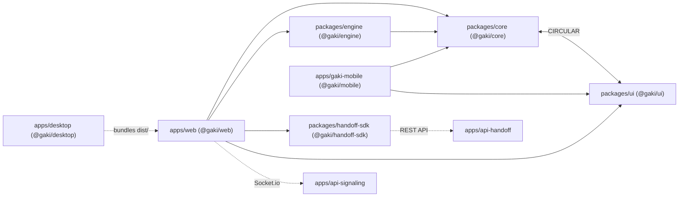

# GAKI Monorepo — Phase 1 Audit Report

> **Branch:** `chore/agent-friendly-cleanup`  
> **Scope:** Read-only audit of `gaki-house` (869 git-tracked files). No source files were modified or deleted.

---

## 1. Baseline Health Check (Before Cleanup)

| Check | Command | Result | Notes |
|---|---|---|---|
| Web Typecheck | `pnpm --filter @gaki/web type-check` | ✅ PASS | `strictNullChecks: false`, `noImplicitAny: false` |
| Handoff SDK Build | `pnpm --filter @gaki/handoff-sdk build` | ✅ PASS | `tsc` compiles cleanly |
| Monorepo Lint | `pnpm run lint` | ❌ FAIL | Only `@gaki/web` and `@gaki/mobile` have `lint` scripts. `@gaki/mobile` fails with **17 errors, 8 warnings** (`no-explicit-any`, `no-unused-expressions`, `no-require-imports`). |
| Mobile Tests | `pnpm --filter @gaki/mobile test` | ✅ PASS | 1 dummy test (`example.test.ts`) |
| Signaling Tests | `pnpm --filter @gaki/api-signaling test` | ❌ FAIL | Exits 1 (`"Error: no test specified"`) |
| Core / Engine / UI / Web / Desktop / Handoff / ML | — | ⚠️ NONE | No test runner configured |

---

## 2. Repo Map

| Path | Role | Main Entry Point(s) |
|---|---|---|
| `apps/web` | Main browser studio (React/Vite broadcast mixer, canvas compositor, `/platform` discovery, `/mobile` views) | `src/main.tsx`, `src/App.tsx`, `vite.config.ts` |
| `apps/gaki-mobile` | Mobile PWA companion (remote stream deck + camera source) | `src/main.tsx`, `src/App.tsx`, `vite.config.ts` |
| `apps/desktop` | Electron wrapper around `apps/web/dist` + native FFmpeg pipe + local RTMP | `electron/main.ts`, `electron/preload.ts`, `electron/rtmp-server.ts` |
| `apps/api-handoff` | Express server vending LiveKit tokens for cross-device handoff | `src/index.ts` |
| `apps/api-signaling` | Socket.io WebRTC broker for Omegle Mode matchmaking | `index.js`, `signaling-server.js` |
| `apps/ml-backend` | Modal FastAPI service for T4 GPU inference + ML-Sharp `.ply` generation | `modal_backend.py` |
| `packages/core` | Shared TypeScript types, constants, hooks, and utility functions | No `index.ts` barrel yet (consumed via deep imports) |
| `packages/engine` | WebGL/Canvas/Audio kernel pipeline (`BroadcastBus`, shaders, OBS parser) | No `index.ts` barrel yet (consumed via deep imports) |
| `packages/handoff-sdk` | Cross-device streaming coordination SDK (LiveKit client wrapper) | `src/index.ts` |
| `packages/ui` | Shared Radix UI + Tailwind component library | No `index.ts` barrel yet (consumed via deep imports) |
| `packages/config-eslint` | Shared ESLint flat config (currently unused by apps) | `base.config.js` |
| `packages/config-typescript` | Shared TypeScript base config (misconfigured with app-level `references`) | `base.json` |
| `scripts/` | One-off Firestore seed/download scripts (`download_firestore.js`, `generate_mobile_designs.js`, `upload_mobile_firestore.js`) | Individual `.js` scripts |
| `docs/` | Root architecture/handoff docs (`ARCHITECTURE.md`, `HANDOFF_FLOW.md`, empty `DEPLOYMENT.md`) | `ARCHITECTURE.md` |
| `tests/` | Empty directory | — |
| `.github/` | GitHub Actions release workflow | `.github/workflows/release.yml` |

---

## 3. Dependency Graph & Boundary Violations

### Critical Findings
1. **Circular Dependency:** `@gaki/core` imports from `@gaki/ui` AND `@gaki/ui` imports from `@gaki/core`.
2. **771 Deep Cross-Package Imports:** Almost every import into `@gaki/ui`, `@gaki/core`, and `@gaki/engine` bypasses a package barrel (e.g., `@gaki/ui/button`, `@gaki/core/types/caption`, `@gaki/engine/kernel/engine/BroadcastBus`), enabled by `paths` aliases in `apps/web/tsconfig.json` and `vite.config.ts`.
3. **Missing `index.ts` Entry Points:** `packages/core`, `packages/engine`, and `packages/ui` lack a single public `index.ts` entrypoint and lack their own `tsconfig.json`.

---

## 4. Files Over 300 Lines (Ranked)

Total tracked code files: **657** | Files > 300 lines: **106** (2 are generated Netlify bundles > 6,700 lines; **104** are actual source files).

### Top 25 Largest Source Files & Suggested Splits

| Lines | File | Suggested Split |
|---|---|---|
| 6,807 | `apps/web/.netlify/functions-serve/kick-proxy/netlify/functions/kick-proxy.js` | **DELETE** (generated Netlify serve bundle) |
| 6,777 | `apps/web/.netlify/functions-serve/proxy/netlify/functions/proxy.js` | **DELETE** (generated Netlify serve bundle) |
| 4,601 | `apps/web/src/index.css` | Split into `styles/tokens.css`, `styles/themes.css`, `styles/animations.css`, `styles/utilities.css` |
| 3,908 | `apps/web/src/features/stream/ui/futuristic-canvas.tsx` | Split into canvas renderer, layer controls, preset/effect bar, and state hooks |
| 1,177 | `apps/web/src/features/stream/services/stream.service.ts` | Split into `audioDsp.ts` (keep DSP constants untouched!), `webrtcTransport.ts`, `recorder.ts`, `streamOrchestrator.ts` |
| 1,136 | `apps/web/src/features/studio/ui/panels/AudioMixerPanel.tsx` | Extract `ChannelStrip.tsx`, `AudioMeter.tsx`, `NoiseGateControls.tsx`, `useAudioMixer.ts` |
| 1,107 | `apps/web/src/features/animation/lib/gsapAnimations.ts` | Split presets by category (`textAnimations.ts`, `entranceAnimations.ts`, `loopAnimations.ts`, `runner.ts`) |
| 1,102 | `apps/web/src/pages/Mobile/components/MobileCanvasContainer.tsx` | Extract gesture handlers, overlay renderer, and scene toolbar |
| 1,079 | `apps/web/src/lib/streamSceneDesigns.ts` | Split static design data JSON/objects by theme family |
| 1,076 | `apps/web/src/pages/Index/hooks/useSceneManager.ts` | Split into `useSceneCrud.ts`, `useScenePersistence.ts`, `useSceneObsImport.ts` |
| 1,015 | `apps/web/src/pages/Mobile/pages/MobileStudioPage.tsx` | Extract bottom sheet panels, camera preview, and stream controls |
| 977 | `apps/web/src/features/theme/model/theme.store.ts` | Move theme preset definitions to `themePresets.ts`, keep store logic < 200 lines |
| 969 | `apps/web/src/features/stream/ui/CinematicOverlay.tsx` | Split overlay presets and rendering layers |
| 904 | `packages/ui/src/color-picker.tsx` | Split `ColorWheel`, `GradientEditor`, `SwatchGrid`, and color math helpers |
| 854 | `apps/desktop/electron/main.ts` | Split into `authServer.ts` (port 3456), `ipcHandlers.ts`, `ffmpegPipe.ts`, `windowManager.ts` |
| 850 | `apps/web/src/features/studio/ui/panels/CanvasDesignsPanel.tsx` | Split tabs (`BackgroundTab`, `LayoutsTab`, `AssetsTab`) |
| 845 | `apps/web/src/features/stream/ui/SceneTabs.tsx` | Extract `SceneTabItem.tsx` and `SceneContextMenu.tsx` |
| 832 | `apps/web/src/features/stream/ui/StreamConfigurationModal.tsx` | Split platform credential forms, stream key inputs, and destination toggles |
| 788 | `apps/web/src/features/canvas/ui/DraggableFileViewer.tsx` | Extract PDF/media/image renderers into separate viewer components |
| 784 | `apps/web/src/features/canvas/ui/CanvasHoverToolbar.tsx` | Audit if dead (retired per `apps/web/CLAUDE.md`); if kept, split toolbar groups |
| 783 | `packages/core/src/types/caption.ts` | Split into `captionTypes.ts` and `captionPresetsData.ts` |
| 770 | `apps/web/src/lib/dynamicCaptionStyles.tsx` | Split style definitions from React renderer component |
| 732 | `apps/web/src/features/canvas/ui/HybridDraggable.tsx` | Extract drag/resize math into `packages/core` or `canvas/math.ts` |
| 697 | `apps/web/src/features/studio/ui/controls/VideoSettingsDialog.tsx` | Split camera device selector, resolution/FPS form, and filter preview |
| 686 | `apps/web/src/lib/gsapHtmlGenerator.ts` | Split HTML template builders from GSAP timeline serialization |

*(Remaining 81 files between 301–685 lines are primarily in `apps/web/src/features/layouts/ui/layouts/dynamic/*`, `apps/web/src/features/studio/ui/panels/*`, `apps/web/src/features/canvas/ui/*`, `apps/web/src/pages/platform/*`, `apps/gaki-mobile/src/features/*`, and `packages/ui/src/sidebar.tsx`.)*

---

## 5. Dead Weight Candidates (With Evidence)

### 5A. Root Scratch & Generated Files (Safe to Delete)
| File / Pattern | Size | Evidence |
|---|---|---|
| `b64.txt` | — | Raw base64 logo string used only by `scratch_fix.js` |
| `replace.js` | 22 lines | One-off codemod script for `HybridDraggable` import |
| `scratch_fix.js` | 48 lines | One-off patch script referencing hardcoded `c:\Users\Dell\Desktop\gaki\...` |
| `apps/web/.netlify/functions-serve/` (6 files) | ~6.6 MB | Local Netlify CLI serve cache (`kick-proxy.js`, `proxy.js`, `.map`, telemetry) accidentally committed |
| `apps/desktop/release/builder-debug.yml` | — | Generated electron-builder debug artifact |
| `apps/web/.env` & `apps/api-handoff/.env` | — | **SECURITY:** Real `.env` files committed to git (already listed in `.gitignore`, must `git rm --cached`) |

### 5B. Empty Files & Directories
- `tests/` (empty root directory)
- `apps/ml-backend/README.md` (0 bytes)
- `docs/DEPLOYMENT.md` (0 bytes)
- `packages/engine/README.md` (0 bytes)

### 5C. Unreferenced Source Files (Need Review Before Deletion)
Static import graph analysis (including `lazy(() => import(...))` and `require(...)`) found:
- **`apps/web/src` (63 / 447 files unreferenced):**
  - Likely retired/superseded: `features/canvas/ui/CanvasHoverToolbar.tsx` (retired per `apps/web/CLAUDE.md`), `features/studio/ui/controls/DownloadControl.tsx`, `features/studio/ui/controls/SceneControls.tsx`, `features/studio/ui/controls/AIControls.tsx` (removed from bottom dock per `CLAUDE.md`), `features/canvas/workers/canvas.worker.ts` (superseded by `packages/engine/src/kernel/workers/canvas.worker.ts`), `components/studio/AbsoluteSceneWrapper.tsx` (duplicated in `features/studio/ui/AbsoluteSceneWrapper.tsx`), `features/auth/ui/AuthModal.tsx` (superseded by `pages/platform/components/AuthModal.tsx`).
  - Old stubbed platform components (per `CLAUDE.md` clean slate): `pages/platform/components/CategoryCard.tsx`, `LiveStreamCarousel.tsx`, `StreamCard.tsx`, `StreamCardHover.tsx`, `StreamComments.tsx`, `SkeletonStreamCard.tsx`, `ChatBadge.tsx`, `EmotePicker.tsx`, `ImageWithFallback.tsx`.
  - Unused hooks/utils/pages: `pages/Edit/*` (5 files — verify if `/edit` route was removed), `hooks/useAutoFraming.ts`, `useCursorFeedback.ts`, `usePredictiveSmoothing.ts`, `usePresetTemplates.ts`, `useSceneCompositor.ts`, `useSubsceneTransition.ts`, `lib/captionPresets.ts`, `lib/filterRenderer.ts`, `lib/presets.ts`, `lib/responsiveUtils.ts`, `lib/utils/performance.ts`, `stores/obsOverlay.store.ts`, `integrations/lovable/index.ts`.
- **`apps/gaki-mobile/src` (5 / 51 files):** `features/effects/workers/effectWorker.ts` (check `new Worker` usage), `features/navigation/ui/NavLink.tsx`, `features/studio/ui/HandoffScreen.tsx`, `features/studio/ui/ScenesScreen.tsx`, `test/setup.ts`.
- **`packages/core/src` (1 / 27):** `hooks/useOnClickOutside.ts`.
- **`packages/engine/src` (4 / 29):** `kernel/engine/EventBus.ts`, `kernel/engine/shaders/composite.ts`, `kernel/engine/webgl.ts` (`canvas.worker.ts` is loaded via `new URL(...)` — **KEEP**).
- **`packages/ui/src` (25 / 54):** Unused Radix/shadcn primitives (`accordion`, `alert`, `aspect-ratio`, `avatar`, `breadcrumb`, `calendar`, `carousel`, `chart`, `checkbox`, `collapsible`, `command`, `context-menu`, `drawer`, `form`, `hover-card`, `input-otp`, `menubar`, `navigation-menu`, `pagination`, `progress`, `resizable`, `sidebar`, `table`, `toggle-group`, `use-toast`).

### 5D. Unused & Duplicate Dependencies
- **Potentially unused `dependencies` (zero string matches in workspace):**
  - `apps/api-signaling`: `dotenv`, `ws`
  - `packages/handoff-sdk`: `uuid`
  - `packages/ui`: `clsx`
  - `apps/gaki-mobile`: 44 unused deps (mostly `@radix-ui/*`, `@gaki/engine`, `@gaki/handoff-sdk`, `recharts`, `embla-carousel-react`, `cmdk`, `vaul`, `react-day-picker`, `react-hook-form`, `zod` — copied from `apps/web`)
  - `apps/web`: ~48 unused deps (`@babel/standalone`, `@mediapipe/*`, `@react-three/cannon`, `ffmpeg-static`, `fluent-ffmpeg`, `node-media-server` [used in `desktop`, not `web`], unused `@radix-ui/*`)
- **45+ version mismatches across `package.json` files**, including:
  - `express`: `^4.22.1` vs `^5.2.1`
  - `node-media-server`: `^2.6.2` vs `^4.2.4`
  - `typescript`: `^5.0.0` vs `^5.8.3` vs `^5.9.3`
  - `three`: `^0.160.0` vs `^0.182.0`
  - `sonner`: `^1.4.3` vs `^1.7.4` vs `^2.0.7`
  - 27 `@radix-ui/react-*` packages at different minor versions between `packages/ui`, `apps/web`, and `apps/gaki-mobile`.

### 5E. Duplicate Logic
- **Stores split in `apps/web`:** `src/store/` (`useHardwareStore.ts`, `useSceneStore.ts`) vs `src/stores/` (11 stores).
- **OBS Parser:** `apps/web/src/lib/obsParser.ts` vs `packages/engine/src/obs/OBSParser.ts`.
- **Canvas Worker:** `apps/web/src/features/canvas/workers/canvas.worker.ts` vs `packages/engine/src/kernel/workers/canvas.worker.ts`.
- **Toast Hook:** `packages/core/src/hooks/use-toast.ts` vs `packages/ui/src/use-toast.ts`.
- **Classname utility:** `apps/gaki-mobile/src/lib/utils.ts` wraps `@gaki/core/lib/utils`.

### 5F. Stale Docs
- `apps/web/docs/` contains **55+ markdown files** (~6,000+ lines) with outdated references to retired components (`CanvasHoverToolbar`, `SceneControls`) and `npm` commands instead of `pnpm`.

---

## 6. Config Sprawl

- **TypeScript:** `packages/config-typescript/base.json` contains app-specific `references` (`./tsconfig.app.json`, `./tsconfig.node.json`) and `@gaki/handoff-sdk` paths, and disables strictness (`noImplicitAny: false`, `strictNullChecks: false`). `apps/web/tsconfig.json` does not extend it. `packages/core`, `packages/engine`, and `packages/ui` have **no `tsconfig.json`**.
- **ESLint:** `packages/config-eslint/base.config.js` is not extended by `apps/web/eslint.config.js` or `apps/gaki-mobile/eslint.config.js`. `apps/desktop`, `apps/api-handoff`, `apps/api-signaling`, and all `packages/*` have no ESLint config or `lint` script.
- **Tailwind / PostCSS:** Duplicated `tailwind.config.ts` and `postcss.config.js` in `apps/web` and `apps/gaki-mobile`.

---

## 7. Comment & Debug Noise Counts

| Category | Count | Notes |
|---|---|---|
| `console.log` | **275** | Top offenders: `WebRTCConnection.ts` (24), `signaling-server.js` (18), `SignalingClient.ts` (17), `OmegleMode.tsx` (16) |
| `console.error` / `warn` / `debug` | **264** | `error`: 188, `warn`: 72, `debug`: 4 |
| Python `print()` | **15** | In `apps/ml-backend` |
| Restating comments | **186** | e.g., `// set state`, `// handle click` |
| Banner / divider comments | **48** | `// ======== ... ========` |
| Commented-out code lines | **22** | Dead code in comments |
| `TODO` / `FIXME` / `HACK` | **7** | 2 older than 6 months (`firebase.ts:6` [2025-11-17], `useBannerEditor.ts:176` [2025-12-09]); 5 from 2026-01 to 2026-05 |
| `debugger` statements | **0** | Clean |
